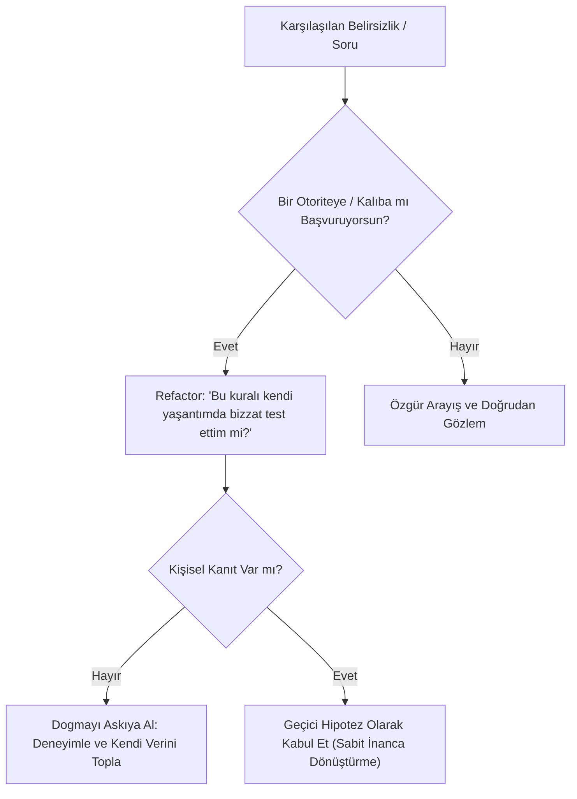
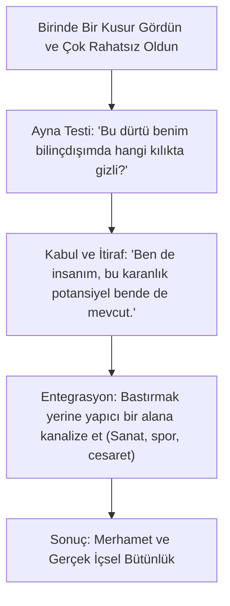

# Felsefi Algoritmalar ve Zihnin Hata Ayıklama (Debugging) Kılavuzu

> *"Bir problem yaratıldığı bilinç seviyesinde çözülemez." — Albert Einstein*

Bu doküman, insan zihninin sıkça düştüğü varoluşsal "sonsuz döngüleri" (infinite loops), bellek sızıntılarını (memory leaks) ve sistem kilitlenmelerini (deadlocks) tespit edip refactor etmek için tasarlanmış felsefi bir algoritma rehberidir.

---

## 🛠 Hata 1: Dogma ve Otorite Bağımlılığı (`Error: ExternalAuthorityException`)

### Belirtiler
* Bir kitaba, lidere, yönteme veya felsefeye körü körüne sarılma.
* Kendi deneyimlerinden şüphe edip başkalarının onayını arama.
* Çelişkili bilgiyle karşılaşıldığında savunmaya geçme ve öfke.

### Hata Ayıklama Algoritması

---

## 🛠 Hata 2: Gölge İnkarı ve Sahte Saflık (`Error: ShadowOverflowException`)

### Belirtiler
* Başkalarının zaaflarını (kibir, şehvet, para hırsı, öfke) aşırı sert kınama (Yansıtma).
* Kusursuz bir ahlak abidesi gibi görünmeye çalışırken içten içe patlama noktasına gelme.
* Ani öfke patlamaları, takıntılar veya suçluluk krizleri.

### Hata Ayıklama Algoritması

---

## 🛠 Hata 3: Zaman İllüzyonu ve Gelecek Kaygısı (`Error: FutureDeadlockException`)

### Belirtiler
* Şimdiki anı gelecekteki bir hedefe varmak için "tahammül edilmesi gereken bir araç" saymak.
* Sürekli "Bir gün şu olunca mutlu olacağım" şartlanması.
* Geçmiş hatalardan dolayı durmaksızın pişmanlık üretmek (Bellek sızıntısı).

### Çözüm Matrisi
| Yanılgı | Refactored Gerçeklik | Felsefi Referans |
| :--- | :--- | :--- |
| "Şimdi acı çekiyorum ama gelecekte kurtulacağım." | Gelecek sadece zihinde var olan bir kurgudur; kurtuluş yalnızca bu nefesteki bilinçle mümkündür. | Siddhartha (Nehir Felsefesi) |
| "Bunu kaybetmemeliydim, geçmişte hata yaptım." | Su aktı ve geçti. Geçmiş değiştirilemez bir veri paketidir; ona bağlanmak sadece bugünün işlemcisini kilitler. | Marcus Aurelius (Stoacılık) |
| "Her şeyi kontrol altına almalıyım." | Kontrol edemeyeceğin akıntıya karşı kürek çekiyorsun. Suya güven. | Taoizm (Wu-Wei) |

---

## 💻 Zihinsel Refactoring Prensibi

1. **Gözlemle:** Yargılamadan önce Vasudeva gibi dinle.
2. **Kabul Et:** Gölgene ve çamuruna kızma; lotusun gübresi oradadır.
3. **Akışa Bırak:** Wu-Wei ile gereksiz sürtünmeyi sıfırla.
4. **Kendi Kodunu Yaz:** Zerdüşt'ün dediği gibi, başkalarının hazır kütüphanelerini ezberlemek yerine kendi hayatının mimarı ol.
