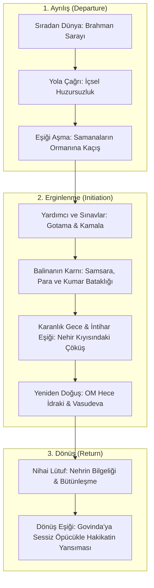

# Kendini Gerçekleştirme ve Kahramanın Yolculuğu: Monomit Analizi

> *"Girmekten en çok korktuğun mağara, aradığın en büyük hazineyi saklar." — Joseph Campbell*

---

## 1. Joseph Campbell ve Kahramanın Sonsuz Yolculuğu (Monomyth)

Mitolog Joseph Campbell, dünya üzerindeki binlerce efsaneyi, masalı ve kutsal metni incelediğinde hepsinin altında yatan tek bir evrensel arketipik şablon keşfetti: **Kahramanın Yolculuğu**.

Bu yolculuk üç ana evreden oluşur:
1. **Ayrılış (Departure):** Bildik dünyanın terk edilmesi.
2. **Erginlenme (Initiation):** Sınavlar, çileler, gölgeyle savaş ve ölüm-yeniden doğum anı.
3. **Dönüş (Return):** Elde edilen bilgelik iksirinin (elixir) dünyaya sunulması.

---

## 2. Siddhartha'nın Yolculuğunun Campbell Haritası

### Aşama Analizi:
* **Yola Çağrı:** Siddhartha'nın babasının sarayında hissettiği o derin susuzluk.
* **Eşik Bekçisi:** Samanaların yaşlı ustası ve Buda Gotama. Siddhartha bu bekçilere boyun eğmez, onları aşar.
* **Balinanın Karnı (Bilinçdışına İniş):** Şehir hayatı, şehvet, kumar ve Kamaswami'nin altınları. Kahraman canavarın midesine iner.
* **Ölüm ve Diriliş:** Nehir kenarındaki hindistancevizi ağacının altında baygın uykuya dalış. Eski günahkâr kimlik ölür.
* **Lütuf:** Nehrin zamansızlık ve birlik sırrını fısıldaması.

---

## 3. Bireyleşmenin (Individuation) Kahramanlık Olarak Doğası

Carl Jung'a göre bu mitolojik yolculuk, aslında her bir insanın psikolojik **Bireyleşme** serüvenidir:
* Canavar, insanın kendi bastırılmış gölgesidir.
* Hazine, bütünleşmiş Öz (Self) bilincidir.
* Kahraman, toplumun hazır reçetelerine sığınmak yerine kendi bilinçdışının karanlık mağarasına inmeye cesaret eden kişidir.

Siddhartha bir kral ya da komutan değildir; ancak kendi zihninin ve yanılsamalarının fatihi olarak tarihin en büyük kahramanlık yolculuğunu tamamlar.
