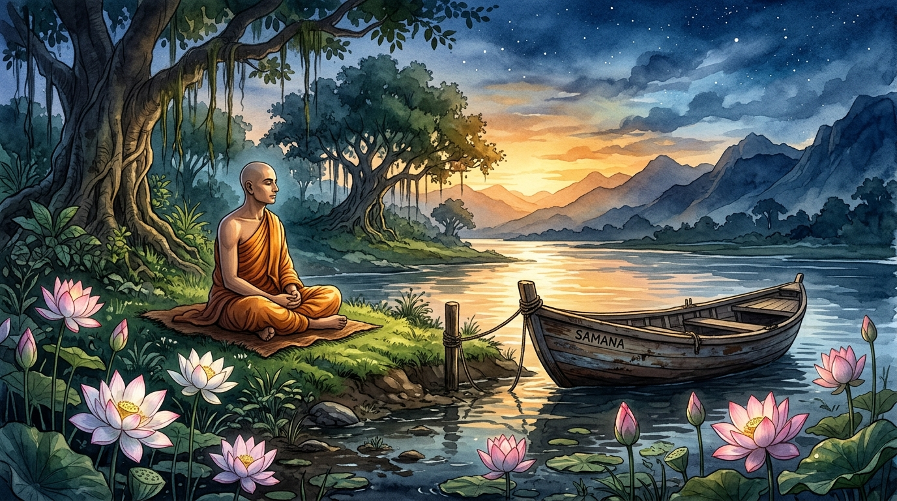
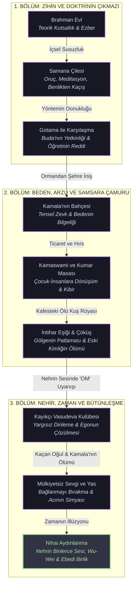
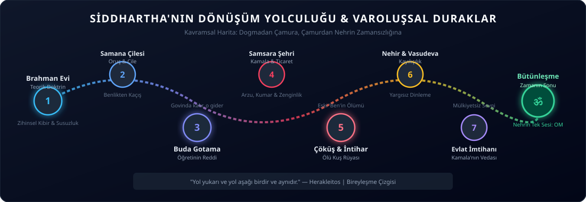
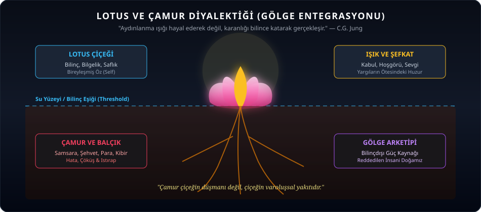
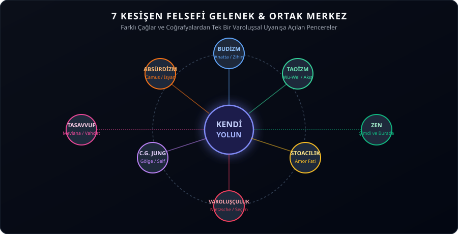

# Kendi Yolun: Deneyimsel Bilgelik ve Karşılaştırmalı Felsefe Arşivi 🍃

> *"Gerçeği gösteren parmak, gerçeğin kendisi değildir." — Zen Atasözü*  
> *"Bilgi aktarılabilir ama bilgelik aktarılamaz. Bilgelik bulunabilir, yaşanabilir, onunla harikalar yaratılabilir... ama söylenemez ve öğretilemez." — Hermann Hesse, Siddhartha*  
> *"Bu benim yolum. Seninki nerede? Çünkü mutlak bir 'yol' diye bir şey yoktur!" — Friedrich Nietzsche, Böyle Buyurdu Zerdüşt*

[](kendi_yolun.py)
[](#-genişletilmiş-depo-mimarisi-7-modül-28-metin)
[](#-büyük-tematik-alıntılar-antolojisi)
[-brightgreen?style=flat-square)](test_kendi_yolun.py)
[](#-etkileşimli-felsefe-motoru-kendi_yolunpy)

<p align="center">
  
</p>

---

## 🧭 Giriş ve Varoluşsal Manifesto

Bu depo; insan zihninin binlerce yıldır düşe kalka aradığı hakikat arayışını, Doğu mistisizminin sezgisel derinliğini ve Batı felsefesinin analitik keskinliğini tek bir potada eriten **açık kaynaklı bir zihinsel işletim sistemi ve deneyimsel bilgelik kütüphanesidir.**

Merkezine Hermann Hesse’nin başyapıtı *Siddhartha*yı alan bu arşiv;
* **Lao Tzu ve Chuang Tzu’nun** akışkan *Tao* ve *Wu-Wei* öğretisini,
* **Carl Gustav Jung’un** bastırılan karanlığı aydınlanmanın yakıtı yapan *Gölge (Shadow)* arketipini,
* **Friedrich Nietzsche’nin** sürü ahlakına ve hazır dogmalara meydan okuyan *Üstinsan* ve *Amor Fati* felsefesini,
* **Arthur Schopenhauer’in** arzu ile can sıkıntısı arasında salınan doyumsuz *İstenç (Wille)* analizini,
* **Marcus Aurelius ve Seneca’nın** Stoacı *Şimdiki An (Hic et Nunc)* ve *Kontrol Dairesi* disiplinini,
* **Martin Heidegger ve Søren Kierkegaard’ın** birey olmanın bedeli olan *Kaygı (Angst)* ve *Ölüme-Doğru-Varlık* idrakini,
* **Albert Camus ve Fyodor Dostoyevski’nin** absürde, mantığın katılığa ve mekanik rasyonalizme karşı irrasyonel başkaldırısını

tek bir varoluşsal yolculukta birleştirir.

**Temel Önerme:**  
Okumak veri almaktır; yazmak ve analiz etmek modeli eğitmektir; ancak bilgelik yalnızca bedenin, günahın, nehrin ve sessizliğin içinden geçerek **bizzat yaşanır**.

---

## 🗺 Siddhartha'nın Yolculuğu ve Varoluşsal Eşikler



<p align="center">
  
</p>

---

## 🏛 Büyük Tematik Alıntılar Antolojisi

Bu arşivde bir araya getirilen düşünürlerin altını çizdiği temel varoluşsal yasalar:

### I. Öğretilerin Sınırı, Dil ve Dogmanın Reddi
> *"Gerçeği arayan kişiyi dinle; bulduğunu söyleyenden uzaklaş."*  
> **— André Gide**

> *"Söze dökülebilen Tao, mutlak Tao değildir. Adlandırılabilen isim, mutlak isim değildir."*  
> **— Lao Tzu, Tao Te Ching (Bölüm 1)**

> *"Üzerine konuşulamayan konusunda susulmalıdır."*  
> **— Ludwig Wittgenstein, Tractatus Logico-Philosophicus**

> *"Kişi, öğretmenine her zaman bir öğrenci olarak kalırsa borcunu kötü öder. Neden çelengimi koparmak istemiyorsunuz? Beni kutsuyorsunuz; ama ya bir gün kutsallığınız çökerse? Bir heykel tarafından ezilmemeye dikkat edin!"*  
> **— Friedrich Nietzsche, Böyle Buyurdu Zerdüşt**

> *"Dolu bir fincana çay dolduramazsın. Bilgelik istiyorsan önce kendi bardağını boşalt."*  
> **— Nan-in (Zen Ustası)**

> *"Bildiğim tek şey hiçbir şey bilmediğimdir."*  
> **— Sokrates**

> *"Hakikat yolsüz bir ülkedir; ona hiçbir örgüt, hiçbir din, hiçbir lider veya dogma yoluyla ulaşılamaz."*  
> **— Jiddu Krishnamurti**

---

### II. Samsara, Gölge ve Günahın Dönüştürücü Simyası
> *"Benim, sırf dünyayı sevebilmek için günaha, şehvete, mala mülke, kibre ve en utanç verici umutsuzluğa ihtiyacım vardı."*  
> **— Hermann Hesse, Siddhartha**

> *"Kişi ışık figürleri hayal ederek değil, karanlığı bilincine katarak aydınlanır. Ancak bu prosedür tatsızdır ve bu yüzden pek popüler değildir."*  
> **— Carl Gustav Jung**

> *"Ağacın dalları göğe kadar uzanmak istiyorsa, kökleri cehennemin en karanlık diplerine kadar inmelidir."*  
> **— Friedrich Nietzsche & C.G. Jung**

> *"Karşıt olan şeyler bir araya gelir ve uzlaşmaz olanlardan en güzel uyum doğar."*  
> **— Herakleitos**

> *"Hayat, bir sarkaç gibi ıstırap ile can sıkıntısı arasında gidip gelir."*  
> **— Arthur Schopenhauer**

> *"2x2=4 artık hayat değil, ölümün başlangıcıdır. İnsan bazen sırf bir piyano tuşu olmadığını kanıtlamak için en yıkıcı günahı bilerek seçer."*  
> **— Fyodor Dostoyevski, Yeraltından Notlar**

> *"Çamur olmasaydı lotus çiçeği nerede kök salıp açardı? Lotus çiçeği çamurun çocuğudur."*  
> **— Thich Nhat Hanh**

> *"Cennete giden yol, cehennemi bizzat tanımaktan geçer."*  
> **— Dante Alighieri**

<p align="center">
  
</p>

---

### III. Nehir, Zamanın İllüzyonu ve Ebedi Şimdi
> *"Siddhartha nehirden şunu öğrendi: Su aynı anda her yerdedir; kaynağında, döküldüğü denizde, şelalede, sandalda, akıntıda, okyanusta ve dağda... Onun için sadece ŞİMDİ vardır; ne geçmişin gölgesi ne geleceğin kaygısı."*  
> **— Hermann Hesse, Siddhartha**

> *"Zaman, içine düşen şeyleri hızla sürükleyen bir sel gibidir. Her olay görünür görünmez sürüklenip gider, onun ardından bir başkası gelir ve o da aynı şekilde kaybolacaktır."*  
> **— Marcus Aurelius, Kendime Düşünceler**

> *"Her gün bir hayattır; her sabah yeniden doğar, her gece ölürüz."*  
> **— Arthur Schopenhauer**

> *"Geçmiş ve gelecek birer yanılsamadır; ikisi de şu anın içinde mevcuttur. Sonsuzluk gelecekte uzanan upuzun bir çizgi değil, bu ânın derinliğidir."*  
> **— Alan Watts**

> *"Dünle beraber gitti cancağızım, ne kadar söz varsa düne ait... Şimdi yeni şeyler söylemek lazım."*  
> **— Mevlana Celaleddin-i Rumi**

> *"Şimdiki zamanı ıskalayan insan, bütün hayatı boyunca yaşayacağını umarak yaşar ama asla yaşayamaz."*  
> **— Seneca, Yaşamın Kısalığı Üzerine**

---

### IV. Wu-Wei, Su Bilgeliği ve Akışa Uyum
> *"Dünyada sudan daha yumuşak ve zayıf hiçbir şey yoktur; ama sert ve güçlü şeylere saldırmada onun üstüne yoktur. Zayıf güçlü olanı yener; yumuşak sert olanı alt eder."*  
> **— Lao Tzu, Tao Te Ching (Bölüm 78)**

> *"Zihnini boşalt. Su gibi formsuz, şekilsiz ol. Suyu bir bardağa koyarsan, bardak olur. Suyu bir şişeye koyarsan, şişe olur. Onu bir çaydanlığa koyarsan, çaydanlık olur. Su akabilir de, ezebilir de. Su gibi ol dostum."*  
> **— Bruce Lee**

> *"Aydınlanmadan önce: Odun kes, su taşı. Aydınlandıktan sonra: Odun kes, su taşı."*  
> **— Zen Özdeyişi**

> *"Yürürken sadece yürü. Otururken sadece otur. Her şeyden önce, asla tereddüt etme."*  
> **— Ummon Zenji**

> *"Yay seni germeli, ok kendiliğinden fırlamalıdır. Sen aradan çekil ki vuran Tanrı olsun."*  
> **— Awa Kenzo (Zen Okçuluk Ustası)**

---

### V. Bireyleşme, Sürüden Ayrılma ve Otantik Yaşam
> *"İnsanın en büyük korkusu ölüm değil; kalabalığın dışına çıkıp bütünüyle kendi olabilmenin getirdiği mutlak yalnızlıktır."*  
> **— Søren Kierkegaard**

> *"Girmekten en çok korktuğun mağara, aradığın en büyük hazineyi saklar."*  
> **— Joseph Campbell**

> *"İnsan ancak kendi ölümünün kaçınılmazlığını göğüslediği zaman sahte gevezelikleri bırakıp otantik bir yaşama adım atabilir."*  
> **— Martin Heidegger**

> *"Sürü insanı vasatlığı sever; çünkü vasatlık güvenlidir. Birey olmak ise uçurumun kenarında tek başına dans etmektir."*  
> **— Friedrich Nietzsche**

> *"Başkalarının teorileri ya da benim kendi fikirlerim değil; yalnızca benim doğrudan deneyimim en yüksek otoritedir."*  
> **— Carl Rogers**

> *"Kendi iç sesini duymak isteyen insan, önce dünyanın gürültüsünü kapatacak kulak tıkaçlarını takmalıdır."*  
> **— Ralph Waldo Emerson**

---

### VI. Sevgi, Ayrılık ve Mülkiyetsiz Merhamet
> *"Bana öyle geliyor ki, en önemli şey sevgidir. Dünyanın içyüzünü kavramak, onu açıklamak büyük düşünürlerin işi olabilir. Ama benim için önemli olan tek şey, dünyayı sevebilmek, onu hor görmemek, ona ve kendime sevgiyle bakabilmektir."*  
> **— Hermann Hesse, Siddhartha**

> *"Sevgi bir mülkiyet değildir. Karşındakine kanat takıp uçmasını izleyebilmektir; onu kafese tıkıp şarkı söylemesini beklemek değil."*  
> **— Halil Cibran**

> *"Tanrı'yı seven bir kimse, Tanrı'nın da kendisini sevmesini bekleyemez."*  
> **— Baruch Spinoza, Etika**

> *"Sevdiğin bir çiçeği koparırsan ölür. Bırak yerinde kalsın. Sevgi sahip olmak değil, takdir etmektir."*  
> **— Osho**

---

### VII. Absürt, İsyan ve Anlamsızlığın İçindeki Anlam
> *"Sisifos'u tepeye tırmanırken mutlu hayal etmek gerekir."*  
> **— Albert Camus, Sisifos Söyleni**

> *"İnsandan her şeyini alabilirsiniz; tek bir şey hariç: İnsanın en son özgürlüğü, başına gelen duruma karşı kendi tavrını seçebilme özgürlüğüdür."*  
> **— Viktor Frankl, İnsanın Anlam Arayışı**

> *"Varoluş özden önce gelir. İnsan önce vardır, karşılaşır, dünyada boy gösterir ve ancak daha sonra kendini tanımlar."*  
> **— Jean-Paul Sartre**

> *"Umutsuzluk içinde dahi yaşamın tadını çıkarmayı öğrenen insan, artık tanrıların bile kölesi olamaz."*  
> **— Emil Cioran**

---

## 📂 Genişletilmiş Depo Mimarisi (7 Modül, 28 Metin)

Tüm belgeler derin kavramsal analizler, edebi karşılaştırmalar ve varoluşsal çıkış haritalarıyla donatılmıştır:

```
kendi_yolun/
│
├── 01-ogretilerin-reddi/                 # Zihnin ve dogmaların aşılması
│   ├── README.md                          # Bölüm manifestosu ve teorik zemin
│   ├── 01-budanin-yolu-ve-sinirlari.md    # Gotama karşılaşması, müritlik vs. birey
│   ├── 02-soze-dokulenin-sahtelesmesi.md  # Lao Tzu, Zen koanları, Wittgenstein
│   ├── 03-ustanin-yolunu-terk-etmek.md    # Nietzsche, Zerdüşt, Kierkegaard sıçraması
│   └── 04-sokratik-bilgisizlik-ve-bos-kadeh.md # Fincanı boşaltmak, Shoshin zihni
│
├── 02-samsara-ve-golge/                   # Beden, arzu ve karanlığın simyası
│   ├── README.md                          # Bölüm manifestosu
│   ├── 01-kamala-ve-kamaswami-maddiyat-ve-arzu.md # Asketizmden şehvete, kuş rüyası
│   ├── 02-jung-ve-golge-arketipi.md       # Persona, Shadow, Enantiodromia
│   ├── 03-lotus-ve-camur.md               # Çamur olmadan lotus açmaz diyalektiği
│   └── 04-arzu-takintisi-ve-schopenhauer.md # Kör istenç, acı-can sıkıntısı sarkacı
│
├── 03-nehir-zaman-ve-tao/                 # Bütünleşme, nehir ve akış bilgeliği
│   ├── README.md                          # Bölüm manifestosu
│   ├── 01-vasudeva-ve-dinleme-sanati.md   # Yargısız dinleme, tanık bilinç (Sakshi)
│   ├── 02-zamanin-illuzyonu-ve-ebedi-simdi.md # Nehir ontolojisi, Stoacı zaman, Spinoza
│   ├── 03-wu-wei-ve-zahmetsiz-eylem.md    # Kaçan oğul imtihanı, Bruce Lee suyu
│   └── 04-anlik-farkindalik-ve-zen-ustaligi.md # Odun kes su taşı, okçuluk ve zazen
│
├── 04-kavram-haritalari/                  # Analitik matrisler ve algoritmalar
│   ├── README.md                          # Bölüm manifestosu
│   ├── 01-capraz-ogreti-matrisi.md        # 5 ekolün 5 boyutta analitik matrisi
│   ├── 02-felsefi-algoritmalar-ve-hata-ayiklama.md # Zihinsel debug akış şemaları
│   ├── 03-sozluk-ve-kavramlar.md          # 10 temel Sanskrit & Grek terim sözlüğü
│   └── 04-varolussal-kriz-rehberi.md      # 4 temel varoluşsal kriz ve reçeteleri
│
├── 05-bireylesme-ve-varolus/              # Kalabalıktan ayrılma cesareti
│   ├── README.md                          # Bölüm manifestosu
│   ├── 01-birey-olma-korkusu-ve-suru-psikolojisi.md # Fromm, sürü ahlakı, baba çatışması
│   ├── 02-kendini-gerceklestirme-ve-kahramanin-yolculugu.md # Campbell monomit analizi
│   ├── 03-olum-bilinci-ve-otantik-yasam.md # Heidegger, Sein-zum-Tode, Memento Mori
│   └── 04-ask-ve-ayrilik-kamalanin-vedasi.md # Kamala'nın ölümü, mülkiyetsiz sevgi
│
├── 06-karsilastirmali-metin-okumalari/     # Edebi ve felsefi paralellikler
│   ├── README.md                          # Bölüm manifestosu
│   ├── 01-siddhartha-ve-bozkirkurdu-karsilastirmasi.md # Harry Haller vs. Siddhartha
│   ├── 02-dostoyevski-yeraltindan-notlar-ve-samsara.md # 2x2=4 tiranlığı ve günah
│   ├── 03-spinoza-etik-ve-nehirdeki-tanri.md # Panteizm, Deus sive Natura, OM
│   └── 04-albert-camus-sisifos-soyleni-ve-anlamsizlik.md # Absürdizm ve kayıkçılık
│
├── 07-gunluk-pratikler-ve-meditasyonlar/  # Uygulamalı bilgelik protokolleri
│   ├── README.md                          # Bölüm manifestosu
│   ├── 01-nehir-meditasyonu-rehberi.md    # 15 dakikalık adım adım nehir meditasyonu
│   ├── 02-golge-gunlugu-ve-yazma-egzersizleri.md # 10 derin psikanalitik gölge sorusu
│   ├── 03-stoaci-aksam-muhasebesi.md      # 3 aşamalı Seneca/Marcus Aurelius filtresi
│   └── 04-wu-wei-eylem-protokolu.md       # Sürtünmesiz karar alma ve eylem adımları
│
├── kendi_yolun.py                         # Etkileşimli CLI ve Felsefi Debug Motoru
├── test_kendi_yolun.py                    # 11 otomatik birim test paketi
├── .gitattributes                         # UTF-8 ve EOL yapılandırması
├── .gitignore                             # Temiz repo hijyeni
└── README.md                              # Ana manifesto ve ansiklopedik rehber
```

---

<p align="center">
  
</p>

## 📊 Kapsamlı Karşılaştırmalı Öğreti Matrisi

| Ekol / Boyut | Epistemoloji (Hakikat Nedir?) | Ontoloji (Benlik / Ego Nedir?) | Zaman Algısı | Karanlık / Gölge / Acı | Eylem Yöntemi (Nasıl Yaşamalı?) |
| :--- | :--- | :--- | :--- | :--- | :--- |
| **Budizm (Erken Dönem)** | Dört Yüce Gerçek; kavramsal aklın ötesindeki saf idrak. | **Anatta:** Sabit ve özerk bir "Ben" yoktur; geçici elementler bütünü. | Döngüsel Samsara çarkı; Neden-Sonuç (Karma) zinciri. | **Dukkha:** Arzu ve tutunmadan kaynaklanır; arzu bitince diner. | Sekiz Dilimli Asil Yol, meditasyon, arzulardan arınma ve Nirvana. |
| **Taoizm (Lao Tzu)** | Söze dökülemeyen kozmik düzen (**Tao**). İsimler gerçeği sınırlar. | Benlik evrenin ayrılmaz bir parçasıdır; yapay ego doğaya aykırıdır. | Sonsuz akış; geçmiş ve gelecek yapay ayrımlardır. | **Yin & Yang:** Karşıtların kusursuz uyumu; karanlık ışığın eşidir. | **Wu-Wei:** Zahmetsiz eylem; zorlamama, su gibi direnmeden akma. |
| **Stoacılık (Roma)** | Akıl (**Logos**) ve doğa kanunlarıyla uyumlu rasyonel gerçeklik. | İçsel kale; irade merkezi. Kontrol edilebilen ve edilemeyen ayrımı. | Zaman hızla akan seldir; sadece **Şimdiki An (Hic et Nunc)** bizimdir. | Acı olaylardan değil, olaylara yüklenen yargılardan doğar. | **Amor Fati:** Kaderini sev; erdemli yaşa, dışsal olaylara kayıtsız kal. |
| **Varoluşçuluk (Nietzsche)** | Hakikat nesnel bir dogma değil; öznel yaşantı, seçim ve cesarettir. | "Varoluş özden önce gelir." Birey kendi değerini sıfırdan kurar. | Geleceğe fırlatılmışlık; anlık seçimlerin sonsuz yankısı. | Acı varoluşun kaçınılmaz bedelidir; insanı bileyleyen yakıttır. | Üstinsan ideali; sürü ahlakını yıkmak, kendi yasasını koymak. |
| **Jungiyen Psikoloji** | Bilinç ve kolektif bilinçdışının sembolik ve dinamik sentezi. | Ego buzdağının tepesidir; gerçek merkez **Öz (Self)**'tir. | Doğrusal değil; Eşzamanlılık (*Synchronicity*) ve döngüler. | **Gölge (Shadow):** Bastırılan karanlık güç; kucaklanmazsa insanı yönetir. | **Bireyleşme (Individuation):** Karşıtların birliği (*coniunctio oppositorum*). |
| **Absürdizm (Camus)** | Evren sağır ve anlamsızdır; hakikat bu uyumsuzluğun bilincindedir. | Anlam yaratmaya çalışan ama evrenin kayıtsızlığına çarpan varlık. | Kaçınılmaz ölüme giden sonlu bir şimdiki an. | Absürt durum; intihar etmek yerine bu saçmalığı göğüslemek. | **İsyan, Özgürlük ve Tutku:** Sisifos gibi kayayı tebessümle itmek. |
| **Sufizm / Tasavvuf** | Aklın ötesinde kalbî keşif ve vahdet (birlik) zevki. | **Nefs:** Ham halden kâmil hale evrilmesi gereken benlik; yoklukta varlık. | İbnü'l-Vakt (Vaktin Çocuğu); geçmiş ve geleceğin ötesinde *Dem*. | Hamdım, piştim, yandım; ayrılık acısı vuslatın tohumudur. | Aşk, seyr-i sülûk, terk-i terk ve mahlukata şefkat nazarıyla bakış. |

---

## 💻 Felsefi Kod ve Hata Ayıklama Algoritmaları

> *"Yazılımda bir bug'ı gizlemek sistemin çöküşünü geciktirir ama engellemez. Zihinde bir gölgeyi bastırmak da aynıdır."*

```python
class HumanMind:
    def __init__(self, name):
        self.name = name
        self.persona = "Toplumsal Maske"
        self.shadow = []  # Bastırılan öfke, kibir, arzu, korku
        self.state = "DOGMA_LOOP"
        self.is_flowing = False

    def face_the_abyss(self):
        """Karanlıkla yüzleşmeden aydınlanma gerçekleşemez."""
        if not self.shadow:
            print("Uyarı: Kusursuzluk kibrine kapıldınız. Gölgeniz taşmak üzere!")
            self.state = "SHADOW_OVERFLOW"
            return False
        
        print("Gölge tanındı ve kabul edildi: Çamursuz lotus açamaz.")
        self.state = "INTEGRATION"
        return True

    def listen_to_the_river(self, listening_deeply=True):
        """Vasudeva gibi yargılamadan dinleme fonksiyonu."""
        if listening_deeply:
            time_is_illusion = True
            all_voices_merge_into_om = True
            self.is_flowing = True
            self.state = "ENLIGHTENMENT"
            return "OM: Bütün sesler tek bir melodide eridi."
        return "Zihin geçmiş ve geleceğe takılı kaldı."

    def execute_wu_wei(self, external_friction):
        """Zorlamadan, su gibi engellerin etrafından akma protokolü."""
        if external_friction:
            # Akıntıya karşı yüzme; akıntının yönünü kullan
            return "Su gibi şekil al; bükül ama kırılma."
        return "Doğal akışla birliktesin."
```

---

## ⚡ Etkileşimli Felsefe Motoru: `kendi_yolun.py`

Arşiv, depodaki tüm kavramları, aforizmaları, meditasyonları ve psikanalitik soruları terminalden doğrudan çalıştırılabilir bir etkileşimli araca dönüştürür. **Sıfır harici paket gerektirir (Python standart kütüphanesi).**

```bash
# 📜 1. Rastgele derin felsefi aforizma, içgörü ve ilgili doküman referansı
python kendi_yolun.py quote

# 🚨 2. Zihinsel bir kilitlenme için felsefi hata ayıklama (debugging)
python kendi_yolun.py debug dogma          # Dogmatizm ve otorite bağımlılığı
python kendi_yolun.py debug golge          # Kusursuzluk taslama ve gölge patlaması
python kendi_yolun.py debug zaman          # Gelecek kaygısı ve geçmiş pişmanlığı
python kendi_yolun.py debug kontrol        # Akışa direnme ve aşırı kontrol
python kendi_yolun.py debug tukenmislik    # Samsara hastalığı ve ölü kuş sendromu
python kendi_yolun.py debug olum_kaygisi   # Ölüm düşüncesi ve geçicilik paniği
python kendi_yolun.py debug anlamsizlik    # Absürt boşluk ve amaç kaybı
python kendi_yolun.py debug suru_baskisi   # Elalem ne der ve sürüye boyun eğme
python kendi_yolun.py debug ask_acisi      # Mülkiyetçi bağlanma ve kayıp acısı

# 🧘 3. Günlük meditasyon veya bilgelik pratiği önerisi al
python kendi_yolun.py practice

# 📝 4. Felsefi günlük yazma şablonu oluştur (Markdown terminal çıktısı)
python kendi_yolun.py journal stoic        # Stoacı akşam muhasebesi şablonu
python kendi_yolun.py journal shadow       # Jungiyen 10 gölge sorusu şablonu

# 🔍 5. Tüm arşiv, aforizmalar ve teşhisler içinde akıllı kelime araması
python kendi_yolun.py search nehir
python kendi_yolun.py search ölüm
python kendi_yolun.py search gölge
python kendi_yolun.py search wu-wei

# 📊 6. 5 Temel felsefi ekolün karşılaştırmalı matrisini görüntüle
python kendi_yolun.py matrix

# 📂 7. 7 Modül ve 28 metinden oluşan arşiv haritasını terminalde keşfet
python kendi_yolun.py explore
```

---

## 📖 Tavsiye Edilen 5 Okuma Rotası

Hangi varoluşsal kavşakta olduğunuza göre seçebileceğiniz özel rota haritaları:

### 1. 🌪 Varoluşsal Kriz ve Tükenmişlik Rotası (Anlam Arayışı İçin)
> *Her şeye sahip olduğu halde ruhunda devasa bir çöl hissedenler için.*
* [`02-samsara-ve-golge/01-kamala-ve-kamaswami-maddiyat-ve-arzu.md`](./02-samsara-ve-golge/01-kamala-ve-kamaswami-maddiyat-ve-arzu.md) — Şehrin bataklığı ve kafesteki kuşun ölümü.
* [`02-samsara-ve-golge/04-arzu-takintisi-ve-schopenhauer.md`](./02-samsara-ve-golge/04-arzu-takintisi-ve-schopenhauer.md) — Schopenhauer ve arzu sarkacı.
* [`04-kavram-haritalari/04-varolussal-kriz-rehberi.md`](./04-kavram-haritalari/04-varolussal-kriz-rehberi.md) — 4 temel kriz ve reçeteleri.
* [`06-karsilastirmali-metin-okumalari/04-albert-camus-sisifos-soyleni-ve-anlamsizlik.md`](./06-karsilastirmali-metin-okumalari/04-albert-camus-sisifos-soyleni-ve-anlamsizlik.md) — Absürde karşı Sisifos'un tebessümü.

### 2. 🦅 Bireyleşme ve Özgürleşme Rotası (Kendi Yolunu Çizenler İçin)
> *Ailesinin, çevresinin ve toplumun beklentileri altında ezilmekten bıkanlar için.*
* [`01-ogretilerin-reddi/03-ustanin-yolunu-terk-etmek.md`](./01-ogretilerin-reddi/03-ustanin-yolunu-terk-etmek.md) — Zerdüşt'ün ayrılık buyruğu.
* [`05-bireylesme-ve-varolus/01-birey-olma-korkusu-ve-suru-psikolojisi.md`](./05-bireylesme-ve-varolus/01-birey-olma-korkusu-ve-suru-psikolojisi.md) — Fromm ve Siddhartha'nın babasına direnişi.
* [`05-bireylesme-ve-varolus/02-kendini-gerceklestirme-ve-kahramanin-yolculugu.md`](./05-bireylesme-ve-varolus/02-kendini-gerceklestirme-ve-kahramanin-yolculugu.md) — Joseph Campbell monomit haritası.

### 3. 🌊 Meditatif Sükunet ve Akış Rotası (Dinginlik İsteyenler İçin)
> *Sürekli gelecek kaygısıyla yaşayan ve her şeyi kontrol etmeye çalışanlar için.*
* [`03-nehir-zaman-ve-tao/01-vasudeva-ve-dinleme-sanati.md`](./03-nehir-zaman-ve-tao/01-vasudeva-ve-dinleme-sanati.md) — Yargısız dinlemenin şifası.
* [`03-nehir-zaman-ve-tao/02-zamanin-illuzyonu-ve-ebedi-simdi.md`](./03-nehir-zaman-ve-tao/02-zamanin-illuzyonu-ve-ebedi-simdi.md) — Zamanın illüzyon oluşu.
* [`03-nehir-zaman-ve-tao/03-wu-wei-ve-zahmetsiz-eylem.md`](./03-nehir-zaman-ve-tao/03-wu-wei-ve-zahmetsiz-eylem.md) — Su gibi olmak ve evlat acısının teslimiyeti.
* [`07-gunluk-pratikler-ve-meditasyonlar/01-nehir-meditasyonu-rehberi.md`](./07-gunluk-pratikler-ve-meditasyonlar/01-nehir-meditasyonu-rehberi.md) — 15 dakikalık nehir pratiği.

### 4. 🌑 Gölge ile Barışma Rotası (İçsel İyileşme İçin)
> *Kendi zaaflarından, hatalarından veya geçmiş günahlarından utananlar için.*
* [`02-samsara-ve-golge/02-jung-ve-golge-arketipi.md`](./02-samsara-ve-golge/02-jung-ve-golge-arketipi.md) — Carl Jung ve gölge entegrasyonu.
* [`02-samsara-ve-golge/03-lotus-ve-camur.md`](./02-samsara-ve-golge/03-lotus-ve-camur.md) — Lotus çiçeğinin gübresi olarak günah.
* [`07-gunluk-pratikler-ve-meditasyonlar/02-golge-gunlugu-ve-yazma-egzersizleri.md`](./07-gunluk-pratikler-ve-meditasyonlar/02-golge-gunlugu-ve-yazma-egzersizleri.md) — 10 derin gölge sorusu.

### 5. 📚 Entelektüel ve Edebi Karşılaştırma Rotası (Felsefe Tutkunları İçin)
> *Felsefe ve dünya edebiyatı arasındaki gizli tünelleri keşfetmek isteyenler için.*
* [`01-ogretilerin-reddi/02-soze-dokulenin-sahtelesmesi.md`](./01-ogretilerin-reddi/02-soze-dokulenin-sahtelesmesi.md) — Wittgenstein ve Zen epistemolojisi.
* [`06-karsilastirmali-metin-okumalari/01-siddhartha-ve-bozkirkurdu-karsilastirmasi.md`](./06-karsilastirmali-metin-okumalari/01-siddhartha-ve-bozkirkurdu-karsilastirmasi.md) — Hesse'nin ikiz romanları.
* [`06-karsilastirmali-metin-okumalari/02-dostoyevski-yeraltindan-notlar-ve-samsara.md`](./06-karsilastirmali-metin-okumalari/02-dostoyevski-yeraltindan-notlar-ve-samsara.md) — Yeraltı adamının isyanı.
* [`06-karsilastirmali-metin-okumalari/03-spinoza-etik-ve-nehirdeki-tanri.md`](./06-karsilastirmali-metin-okumalari/03-spinoza-etik-ve-nehirdeki-tanri.md) — Spinoza Etika ve nehrin panteist korosu.

---

## 📚 Temel Kavramlar ve Etimoloji Sözlüğü

* **Samsara (संसار):** Doğum, ölüm ve dünyevi yanılsamaların bitimsiz çarkı.
* **Maya (माया):** Hakikatin üzerini örten duyusal illüzyon ve serap örtüsü.
* **Atman (आत्मन्):** İnsanın en derinindeki ebedi öz, saf bireysel kıvılcım.
* **Brahman (ब्रह्मन्):** Evrenin nihai, sonsuz ve bölünemez mutlak bilinci.
* **Tat Tvam Asi (तत् त्वम् असि):** *"Sen O'sun!"* Bireysel ruhun evrensel bilinçten ayrı olmadığını haykıran Upanişad formülü.
* **Wu-Wei (無為):** Eylemsizlik değil; zorlamadan, doğanın akışına uyum sağlayarak gerçekleştirilen zahmetsiz ustalık.
* **Gölge (Shadow):** Bilinçli benliğin reddettiği, utandığı veya bastırdığı karanlık potansiyel.
* **Bireyleşme (Individuation):** İnsanın tüm karşıt kutuplarını bilince katarak bölünmez bir bütün (Self) haline gelmesi.
* **Enantiodromia (ἐναντιοδρομία):** Aşırıya kaçan her tutumun eninde sonunda kendi tam zıttına dönüşmesi ilkesi.
* **Amor Fati:** Başına gelen kaderi sadece kabullenmek değil, onu varoluşunun zorunlu güzelliği sayarak sevmek.
* **Sein-zum-Tode:** İnsanın kendi ölümünün bilincinde olarak yaşaması; otantik varoluşun önkoşulu.
* **OM (ॐ):** Evrenin tözsel titreşimi; tüm zıtlıkların, acıların ve melodilerin birleştiği yetkin birlik sesi.

---

## 🛠 Katkıda Bulunma ve Manifestonun Ruhu

Bu depo statik bir kütüphane değil, canlı bir tefekkür havuzudur. 
* Yeni filozof ve yazar paralellikleri önerebilir,
* Varoluşsal kriz senaryolarına yeni felsefi algoritmalar ekleyebilir,
* Okuma notlarınızı ve aforizmalarınızı `pull request` olarak sunabilirsiniz.

> *"Ben bir bilge değilim; arayan biriyim. Ancak aramayı bıraktığımda, nehir bana her şeyi anlattı."*

**Okumak veri almaktır; yazmak ve analiz etmek ise modeli eğitmektir.**

*Kendi hakikatini arayan ve nehir kıyısında durup dinlemeye cesaret edenlere...* 🍃
