# Kendi Yolun: Deneyimsel Bilgelik ve Karşılaştırmalı Felsefe Arşivi 🍃

> *"Gerçeği gösteren parmak, gerçeğin kendisi değildir." — Zen Atasözü*

[](kendi_yolun.py)
[](#-genişletilmiş-depo-mimarisi-7-modül)
[](#-tematik-analizler-ve-kesişen-öğretiler)
[](test_kendi_yolun.py)

Bu depo; bilginin aktarılabilir, ancak bilgeliğin yalnızca **yaşanabilir** olduğu tezi üzerine inşa edilmiş, çok disiplinli bir felsefe, analitik psikoloji, edebiyat ve uygulamalı meditasyon arşividir.

Merkezine Hermann Hesse’nin *Siddhartha* eserini alan bu arşiv; Taoizm'in akışını, Carl Gustav Jung'un "Gölge" arketipini, Friedrich Nietzsche'nin varoluşçu isyanını, Arthur Schopenhauer'in arzu sarkacını, Martin Heidegger'in otantik ölüm bilincini ve Stoacıların zaman algısını tek bir potada eriterek, bireyin **kendi hakikatini inşa etme sürecini** belgeler.

---

## 🗺 Siddhartha'nın Yolculuğu ve Varoluşsal Eşikler

```mermaid
flowchart LR
    A["Brahman Evi<br/><i>(Dogmatik Teori)</i>"] --> B["Samana Çilesi<br/><i>(Benlikten Kaçış)</i>"]
    B --> C["Gotama Karşılaşması<br/><i>(Öğretinin Reddi)</i>"]
    C --> D["Samsara Şehri<br/><i>(Kamala, Para, Kumar)</i>"]
    D --> E["Çöküş & İntihar Eşiği<br/><i>(Gölgenin Patlaması)</i>"]
    E --> F["Nehir & Vasudeva<br/><i>(Zamanın İllüzyonu & Dinleme)</i>"]
    F --> G["Baba Olmak & Yas<br/><i>(Mülkiyetsiz Sevgi)</i>"]
    G --> H["Bütünleşme<br/><i>(Wu-Wei & OM Sesi)</i>"]

    classDef stage fill:#1e1e2e,stroke:#89b4fa,stroke-width:2px,color:#cdd6f4;
    classDef peak fill:#313244,stroke:#a6e3a1,stroke-width:2px,color:#a6e3a1;
    class A,B,C,D,E,F,G stage;
    class H peak;
```



---

## 📂 Genişletilmiş Depo Mimarisi (7 Modül, 28 Metin)

### 1. [`/01-ogretilerin-reddi`](./01-ogretilerin-reddi/) — Zihnin ve Dogmaların Aşılması
* [Bölüm Özeti ve Manifestosu](./01-ogretilerin-reddi/README.md)
* [01. Buda'nın Yolu ve Sınırları](./01-ogretilerin-reddi/01-budanin-yolu-ve-sinirlari.md): Gotama'nın sisteminin aydınlanmayı aktaramayışı; Govinda (mürit) vs. Siddhartha (birey).
* [02. Söze Dökülenin Sahteleşmesi](./01-ogretilerin-reddi/02-soze-dokulenin-sahtelesmesi.md): Lao Tzu, Zen koanları ve Wittgenstein epistemolojisi; dilin gerçeği dondurması.
* [03. Ustanın Yolunu Terk Etmek](./01-ogretilerin-reddi/03-ustanin-yolunu-terk-etmek.md): Nietzsche'nin Zerdüşt'ü, Kierkegaard'ın inanç sıçraması ve Carl Rogers'ın doğrudan yaşantı otoritesi.
* [04. Sokratik Bilgisizlik ve Boş Kadeh](./01-ogretilerin-reddi/04-sokratik-bilgisizlik-ve-bos-kadeh.md): Taşan çay fincanı metaforu, Sokrates'in aporia yöntemi ve bilgelik için zihni boşaltma zorunluluğu.

### 2. [`/02-samsara-ve-golge`](./02-samsara-ve-golge/) — Beden, Arzu ve Gölgenin İntegrasyonu
* [Bölüm Özeti ve Manifestosu](./02-samsara-ve-golge/README.md)
* [01. Kamala ve Kamaswami: Maddiyat ve Arzu](./02-samsara-ve-golge/01-kamala-ve-kamaswami-maddiyat-ve-arzu.md): Asketizmden şehvete geçiş, çocuk-insanlara dönüşüm ve kafesteki ölü kuş rüyası.
* [02. Jung ve Gölge Arketipi](./02-samsara-ve-golge/02-jung-ve-golge-arketipi.md): Persona ve Shadow çatışması, Herakleitosyen *Enantiodromia* ve karanlığı bilince katma.
* [03. Lotus ve Çamur](./02-samsara-ve-golge/03-lotus-ve-camur.md): Doğu bilgeliğinde çamursuz lotusun açamayacağı gerçeği; hatanın dönüştürücü simyası.
* [04. Arzu Takıntısı ve Schopenhauer](./02-samsara-ve-golge/04-arzu-takintisi-ve-schopenhauer.md): İstenç ve Tasarım Olarak Dünya; ıstırap ile can sıkıntısı sarkacının kırılması.

### 3. [`/03-nehir-zaman-ve-tao`](./03-nehir-zaman-ve-tao/) — Bütünleşme ve Akış Bilgeliği
* [Bölüm Özeti ve Manifestosu](./03-nehir-zaman-ve-tao/README.md)
* [01. Vasudeva ve Dinleme Sanatı](./03-nehir-zaman-ve-tao/01-vasudeva-ve-dinleme-sanati.md): Yargılamadan dinlemenin dönüştürücü şifası, kayıkçı arketipi ve tanık bilinç (*Sakshi*).
* [02. Zamanın İllüzyonu ve Ebedi Şimdi](./03-nehir-zaman-ve-tao/02-zamanin-illuzyonu-ve-ebedi-simdi.md): Suyun her koordinatta eşzamanlılığı, Marcus Aurelius ve Stoacı zaman, Spinoza'nın ebediyeti.
* [03. Wu-Wei ve Zahmetsiz Eylem](./03-nehir-zaman-ve-tao/03-wu-wei-ve-zahmetsiz-eylem.md): Kaçan oğlunu serbest bırakış, zorlamama ilkesi ve Bruce Lee'nin "su gibi ol" öğretisi.
* [04. Anlık Farkındalık ve Zen Ustalığı](./03-nehir-zaman-ve-tao/04-anlik-farkindalik-ve-zen-ustaligi.md): Sıradan olanın kutsallığı (odun kes, su taşı), okçulukta Zen ve kayık çekmenin zazen hali.

### 4. [`/04-kavram-haritalari`](./04-kavram-haritalari/) — Analitik Araçlar, Matrisler ve Algoritmalar
* [Bölüm Özeti ve Manifestosu](./04-kavram-haritalari/README.md)
* [01. Çapraz Öğreti Matrisi](./04-kavram-haritalari/01-capraz-ogreti-matrisi.md): Budizm, Taoizm, Stoacılık, Varoluşçuluk ve Jung Psikolojisinin 5 boyutta analizi.
* [02. Felsefi Algoritmalar ve Zihnin Debug Süreci](./04-kavram-haritalari/02-felsefi-algoritmalar-ve-hata-ayiklama.md): Dogma Loop, Shadow Overflow ve Future Deadlock için akış diyagramları.
* [03. Felsefi Kavramlar Sözlüğü](./04-kavram-haritalari/03-sozluk-ve-kavramlar.md): Samsara, Maya, Atman, Brahman, Wu-Wei, Amor Fati, Bireyleşme, Enantiodromia, Om.
* [04. Varoluşsal Kriz Rehberi](./04-kavram-haritalari/04-varolussal-kriz-rehberi.md): Anlamsızlık, değerler çöküşü (nihilizm), ölüm kaygısı ve suçluluk krizleri için reçeteler.

### 5. [`/05-bireylesme-ve-varolus`](./05-bireylesme-ve-varolus/) — Kalabalıktan Ayrılma ve Özgürleşme
* [Bölüm Özeti ve Manifestosu](./05-bireylesme-ve-varolus/README.md)
* [01. Birey Olma Korkusu ve Sürü Psikolojisi](./05-bireylesme-ve-varolus/01-birey-olma-korkusu-ve-suru-psikolojisi.md): Erich Fromm'un *Özgürlükten Kaçış* kuramı, Nietzsche'nin 'Sürü İnsanı' ve Siddhartha'nın babasına başkaldırısı.
* [02. Kendini Gerçekleştirme ve Kahramanın Yolculuğu](./05-bireylesme-ve-varolus/02-kendini-gerceklestirme-ve-kahramanin-yolculugu.md): Joseph Campbell monomit analizi: Çağrı, balinanın karnı, karanlık gece ve nihai lütuf.
* [03. Ölüm Bilinci ve Otantik Yaşam](./05-bireylesme-ve-varolus/03-olum-bilinci-ve-otantik-yasam.md): Martin Heidegger'in *Sein-zum-Tode* kavramı, Das Man gevezeliği ve nehirdeki ölümlerin idraki.
* [04. Aşk ve Ayrılık: Kamala'nın Vedası](./05-bireylesme-ve-varolus/04-ask-ve-ayrilik-kamalanin-vedasi.md): Kamala'nın ölümü, yılan ısırığı, yas süreci ve aşkın mülkiyetsiz bir bilince dönüşmesi.

### 6. [`/06-karsilastirmali-metin-okumalari`](./06-karsilastirmali-metin-okumalari/) — Edebi ve Felsefi Paralellikler
* [Bölüm Özeti ve Manifestosu](./06-karsilastirmali-metin-okumalari/README.md)
* [01. Siddhartha ve Bozkırkurdu Karşılaştırması](./06-karsilastirmali-metin-okumalari/01-siddhartha-ve-bozkirkurdu-karsilastirmasi.md): Harry Haller'in intihar eşiği, Sihirli Tiyatro ve burjuva ikiliği vs. Siddhartha'nın nehir bütünlüğü.
* [02. Dostoyevski: Yeraltından Notlar ve Samsara](./06-karsilastirmali-metin-okumalari/02-dostoyevski-yeraltindan-notlar-ve-samsara.md): 2x2=4 rasyonalizmine isyan, irrasyonel insan doğası ve günaha batışın ortak felsefesi.
* [03. Spinoza: Etika ve Nehirdeki Tanrı](./06-karsilastirmali-metin-okumalari/03-spinoza-etik-ve-nehirdeki-tanri.md): *Deus sive Natura* (Tanrı ya da Doğa); panteist koro ve evrenin entelektüel sevgisi.
* [04. Albert Camus: Sisifos Söyleni ve Anlamsızlık](./06-karsilastirmali-metin-okumalari/04-albert-camus-sisifos-soyleni-ve-anlamsizlik.md): Absürdizm, anlamsızlığa karşı onurlu isyan ve kayıkçılık emeğinde yaratılan derin anlam.

### 7. [`/07-gunluk-pratikler-ve-meditasyonlar`](./07-gunluk-pratikler-ve-meditasyonlar/) — Uygulamalı Bilgelik Protokolleri
* [Bölüm Özeti ve Manifestosu](./07-gunluk-pratikler-ve-meditasyonlar/README.md)
* [01. Nehir Meditasyonu Rehberi](./07-gunluk-pratikler-ve-meditasyonlar/01-nehir-meditasyonu-rehberi.md): Düşünceleri yapraklar gibi yargısızca izleme tekniği (15 dakikalık pratik).
* [02. Gölge Günlüğü ve Yazma Egzersizleri](./07-gunluk-pratikler-ve-meditasyonlar/02-golge-gunlugu-ve-yazma-egzersizleri.md): 10 derin gölge sorusu ve projektif duyguları çözme rehberi.
* [03. Stoacı Akşam Muhasebesi](./07-gunluk-pratikler-ve-meditasyonlar/03-stoaci-aksam-muhasebesi.md): Kontrol dairesi ayrımı, kusur tespiti ve evrensel şükran protokolü.
* [04. Wu-Wei Eylem Protokolü](./07-gunluk-pratikler-ve-meditasyonlar/04-wu-wei-eylem-protokolu.md): Karar anlarında sürtünmeyi sıfırlama, zorlamayı bırakma ve akışkan odaklanma adımları.

---

## ⚡ Etkileşimli Felsefe Motoru: `kendi_yolun.py`

Arşiv, tüm bu felsefi birikimi terminalden yaşanabilir bir araca dönüştüren harici bağımlılıksız (sıfır kurulum) yerel bir CLI motoruyla birlikte gelir:

```bash
# 1. Rastgele derin felsefi aforizma ve içgörü al
python kendi_yolun.py quote

# 2. Zihinsel bir kilitlenme için felsefi hata ayıklama (debugging) yap
python kendi_yolun.py debug dogma
python kendi_yolun.py debug golge
python kendi_yolun.py debug zaman
python kendi_yolun.py debug kontrol
python kendi_yolun.py debug tukenmislik
python kendi_yolun.py debug olum_kaygisi
python kendi_yolun.py debug anlamsizlik
python kendi_yolun.py debug suru_baskisi
python kendi_yolun.py debug ask_acisi

# 3. Günlük pratik veya meditasyon önerisi al
python kendi_yolun.py practice

# 4. Stoacı veya gölge çalışması günlük şablonu oluştur
python kendi_yolun.py journal stoic
python kendi_yolun.py journal shadow

# 5. Arşiv içinde akıllı arama yap
python kendi_yolun.py search nehir
python kendi_yolun.py search zaman
python kendi_yolun.py search gölge

# 6. 5 Temel felsefi ekolün karşılaştırmalı matrisini görüntüle
python kendi_yolun.py matrix

# 7. Tüm genişletilmiş arşiv mimarisini terminalde keşfet
python kendi_yolun.py explore
```

---

## 📖 Tavsiye Edilen Okuma Rotaları

1. **Varoluşsal Kriz Rotası (Anlam arayışı, tükenmişlik ve kayıp):**
   * [`02-samsara-ve-golge/01-kamala-ve-kamaswami-maddiyat-ve-arzu.md`](./02-samsara-ve-golge/01-kamala-ve-kamaswami-maddiyat-ve-arzu.md) ➔ [`04-kavram-haritalari/04-varolussal-kriz-rehberi.md`](./04-kavram-haritalari/04-varolussal-kriz-rehberi.md) ➔ [`06-karsilastirmali-metin-okumalari/04-albert-camus-sisifos-soyleni-ve-anlamsizlik.md`](./06-karsilastirmali-metin-okumalari/04-albert-camus-sisifos-soyleni-ve-anlamsizlik.md)
2. **Bireyleşme ve Özgürleşme Rotası (Toplum baskısı ve kendi yolunu çizmek):**
   * [`01-ogretilerin-reddi/03-ustanin-yolunu-terk-etmek.md`](./01-ogretilerin-reddi/03-ustanin-yolunu-terk-etmek.md) ➔ [`05-bireylesme-ve-varolus/01-birey-olma-korkusu-ve-suru-psikolojisi.md`](./05-bireylesme-ve-varolus/01-birey-olma-korkusu-ve-suru-psikolojisi.md) ➔ [`05-bireylesme-ve-varolus/02-kendini-gerceklestirme-ve-kahramanin-yolculugu.md`](./05-bireylesme-ve-varolus/02-kendini-gerceklestirme-ve-kahramanin-yolculugu.md)
3. **Meditatif & Akış Rotası (Dinginlik, kabulleniş ve pratik):**
   * [`03-nehir-zaman-ve-tao/02-zamanin-illuzyonu-ve-ebedi-simdi.md`](./03-nehir-zaman-ve-tao/02-zamanin-illuzyonu-ve-ebedi-simdi.md) ➔ [`03-nehir-zaman-ve-tao/03-wu-wei-ve-zahmetsiz-eylem.md`](./03-nehir-zaman-ve-tao/03-wu-wei-ve-zahmetsiz-eylem.md) ➔ [`07-gunluk-pratikler-ve-meditasyonlar/01-nehir-meditasyonu-rehberi.md`](./07-gunluk-pratikler-ve-meditasyonlar/01-nehir-meditasyonu-rehberi.md)
4. **Felsefi & Edebi Karşılaştırma Rotası (Entelektüel derinleşme):**
   * [`06-karsilastirmali-metin-okumalari/01-siddhartha-ve-bozkirkurdu-karsilastirmasi.md`](./06-karsilastirmali-metin-okumalari/01-siddhartha-ve-bozkirkurdu-karsilastirmasi.md) ➔ [`06-karsilastirmali-metin-okumalari/02-dostoyevski-yeraltindan-notlar-ve-samsara.md`](./06-karsilastirmali-metin-okumalari/02-dostoyevski-yeraltindan-notlar-ve-samsara.md) ➔ [`06-karsilastirmali-metin-okumalari/03-spinoza-etik-ve-nehirdeki-tanri.md`](./06-karsilastirmali-metin-okumalari/03-spinoza-etik-ve-nehirdeki-tanri.md)

---

## 🛠 Projenin Amacı
Bu repo; kitap sayfaları arasında kaybolup gidecek altı çizili cümleleri birer kod satırı gibi işlemek, felsefi algoritmalar kurmak ve insan zihninin "hata ayıklama" (debugging) sürecini metne dökmek için tasarlanmıştır.

**Okumak veri almaktır; yazmak ve analiz etmek ise modeli eğitmektir.**

*Kendi hakikatini arayanlara...*
